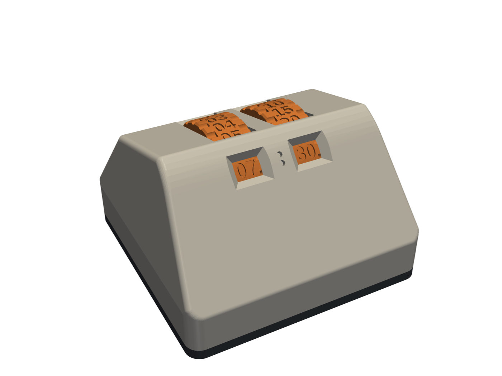
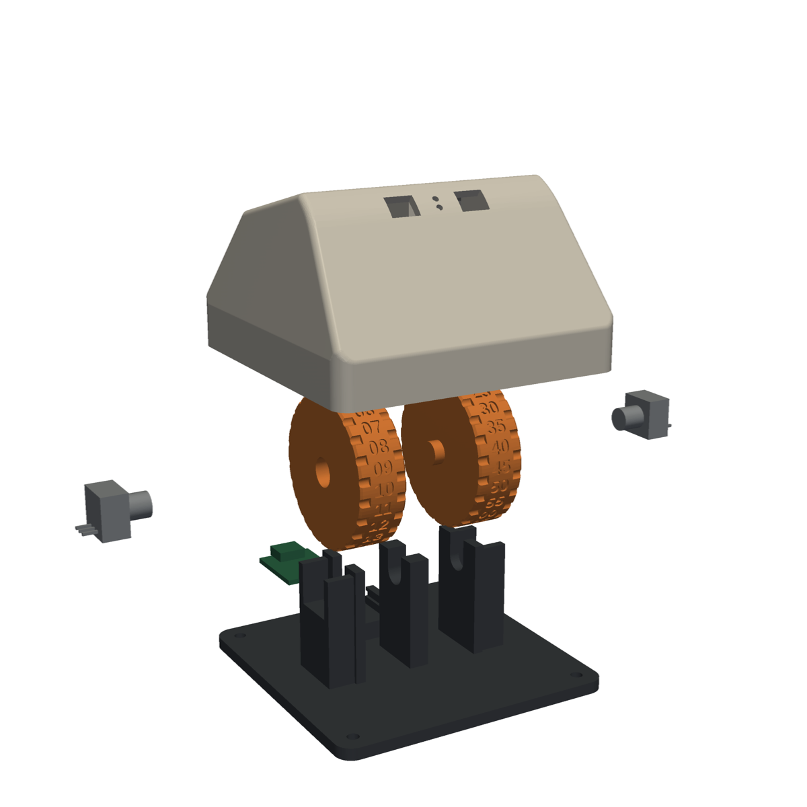
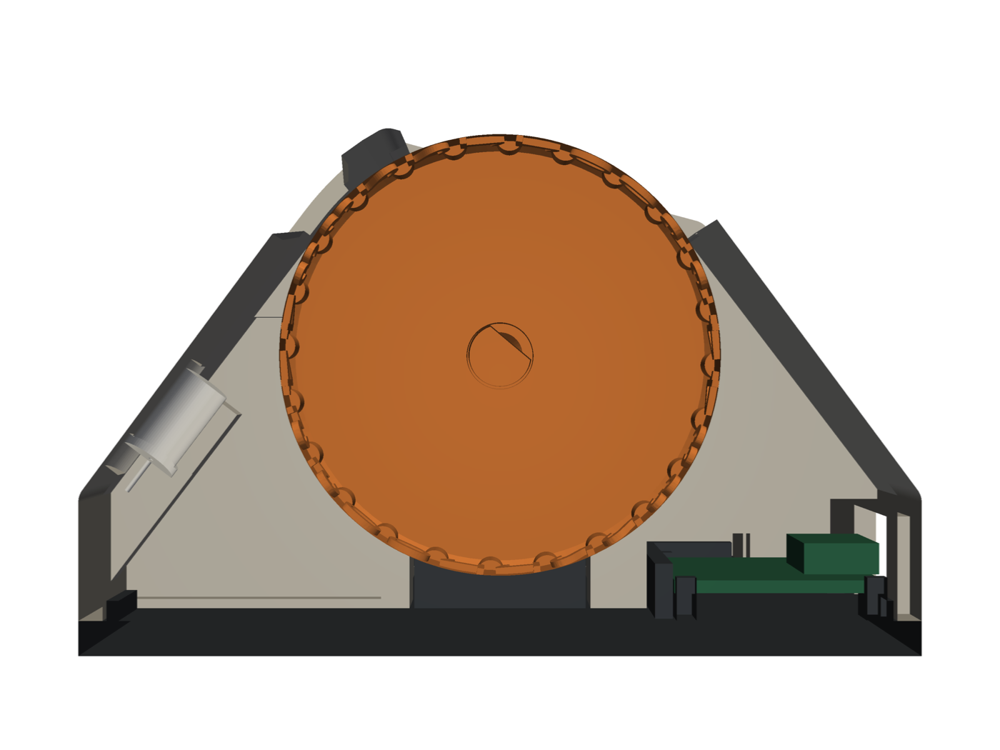

# HueWheel

A small bedside controller for setting a Philips Hue wake-up light by feel. Roll two notched
wheels, like a mouse scroll wheel, and the time reads through a window like a combination
lock. There's no screen and no app to open, and a switch on the side turns the alarm on or off.



| Exploded | Cutaway |
|---|---|
|  |  |

> **Project status:** this is an untested first build. Nothing has been printed yet and the
> firmware hasn't run on a real board. Changing a real alarm has only been tried from a PC, on
> a BSB002 bridge. Expect to adjust things along the way: [what might need adjusting](#what-might-need-adjusting).

## Using it

- **Left wheel: hours.** Runs 00-23, one hour per click.
- **Right wheel: minutes.** Moves in 5-minute clicks. 00-55 appears twice around the wheel.
- **Roll a wheel away from you** to go later.
- **Slide switch on the right:** alarm on or off.

Stop touching it, and about 2.5 seconds later the new time goes to your Hue Bridge. The windows
light up for 5 seconds after each click, so you can read them in the dark.

**A short blink every 5 seconds means the bridge doesn't have your latest time yet**, usually
because Wi-Fi is down. It keeps retrying, but don't rely on the alarm until the blinking stops.

Good to know:

- It changes the time and on/off only. The days, rooms and fade stay as you set them in the
  Hue app, so an alarm set to weekdays won't ring on a Saturday.
- The wheels can't move themselves. If you change the alarm in the Hue app, the wheels will
  show the old time until you next roll one, and then the wheels' time wins.
- It needs USB power all the time. It keeps its position through a power cut, as long as
  nobody turns a wheel while it's unplugged.

## Building one

You'll need a 3D printer, a soldering iron, a hot glue gun, and a Linux PC for flashing the
firmware. The commands here are for Linux, and they start from the top folder of this repo
unless a step says otherwise.

### 1. Get the parts

The full list is in [`bom/HueWheel_BOM.xlsx`](bom/HueWheel_BOM.xlsx). Fill in its Have? column
and the total updates. From scratch you need:

- A Philips Hue Bridge with at least one Wake Up automation set up in the Hue app
- 2 Bourns PEC11R-4215F-N0024 rotary encoders. **It must be a 24-detent model**, because the
  wheel numbering depends on it.
- 1 Seeed XIAO ESP32C3, the version without pre-soldered headers
- 1 E-Switch EG1201A slide switch
- 2 LEDs, 3 mm, red or amber
- 2 resistors, 220-470 ohm
- 4 M3 x 8 button head screws and 4 M3 nuts
- Hookup wire, about 1 m in total
- A USB charger, and a USB-A to USB-C cable that carries data
- About 120 g of PLA

The electronics come from one DigiKey order. With the small parts already on hand, that's
about $18.70 including an estimated $7 shipping, plus about $6 for the charger and cable if
you need them. These are estimates, so check them at checkout.

### 2. Print the parts

**Print one wheel first** and try it on an encoder. The fit comes from the datasheet and hasn't
been tried on a real part. If it fits, print the rest from [`cad/stl`](cad/stl):

| Part | File | Supports |
|---|---|---|
| Base plate | `plate.stl` | None |
| Shell | `shell.stl` | From the build plate only |
| Hours wheel | `wheel_hours.stl` | None |
| Minutes wheel | `wheel_minutes.stl` | None |

The files are already in the right orientation. Expect about 119 g and 10 hours in total, or
somewhat different on your printer. Those figures are for 0.2 mm layers and 15% infill.

Darken the engraved numerals with a fine marker or paint pen. Use black or another dark
colour, because a red numeral disappears under a red LED.

### 3. Wire the electronics

Solder everything together **before** gluing anything into the shell, leaving enough wire to
reach each part's final position.

| From | To XIAO pin |
|---|---|
| Hours encoder (left), pin A | D1 |
| Hours encoder (left), pin B | D2 |
| Minutes encoder (right), pin A | D3 |
| Minutes encoder (right), pin B | D4 |
| Both encoders, centre pin C | GND |
| Slide switch, centre lug | D5 |
| Slide switch, one outer lug | GND |
| Each LED long leg, through its own resistor | D10 |
| Each LED short leg | GND |

Leave the other switch lug unconnected, and leave D0, D8 and D9 free, because they can stop the
board booting. Cover the resistor joints with tape or heat shrink. Connect the included
antenna to the XIAO.

### 4. Pair with your Hue Bridge

The Python tool below needs no extra packages. It stores everything in
`firmware/include/secrets.h`, which git ignores.

1. Find the bridge:
   ```bash
   python3 tools/hue_dryrun.py discover
   ```
2. Press the round button on top of the bridge, then within 30 seconds run:
   ```bash
   python3 tools/hue_dryrun.py pair
   ```
3. List your Wake Up automations and find the one the wheels should control. Each one shows
   its name under `metadata` and its `id` at the top:
   ```bash
   python3 tools/hue_dryrun.py list
   ```
4. Choose it, using that `id`:
   ```bash
   python3 tools/hue_dryrun.py use <id>
   ```
   While you're testing, pick a spare automation that's switched off, so your real alarm stays
   safe. You can run this again and re-upload when the device is ready for real use.
5. Open `firmware/include/secrets.h` and fill in `WIFI_SSID` and `WIFI_PASSWORD`. The network
   must be **2.4 GHz**, because this board has no 5 GHz radio.

Then give the bridge a fixed address in your router (a "DHCP reservation"). The device doesn't
search for the bridge, so it loses contact if that address changes.

You can also try a change from your PC first. `plan` only shows what would be sent, `apply`
really sends it, and `restore` undoes it:

```bash
python3 tools/hue_dryrun.py plan 07:30 on
python3 tools/hue_dryrun.py apply 07:30 on
python3 tools/hue_dryrun.py restore
```

### 5. Upload the firmware

1. Install PlatformIO, which only needs doing once. The first build also downloads several
   hundred MB of tools.
   ```bash
   python3 -m venv ~/.platformio-venv
   ~/.platformio-venv/bin/pip install platformio
   alias pio=~/.platformio-venv/bin/pio
   ```
   Add that `alias` line to `~/.bashrc` to keep it.
2. Plug in the XIAO, then from the `firmware` folder upload and watch the log:
   ```bash
   cd firmware
   pio run -t upload
   pio device monitor
   ```
3. Check the log shows `boot, wheels: 07:00 off` or `on`, then `wifi: connected`. If it scrolled
   past before the monitor opened, press the board's RESET button.

**If it can't connect to the board:** hold BOOT, tap RESET, release BOOT, then upload again.
Tap RESET once afterwards. **If the board doesn't show up at all**, try another cable first,
because many USB cables only carry power. If you get a permission error, add yourself to the
serial group: `dialout` on Ubuntu and Debian, `uucp` on Arch.

### 6. Test on the bench

With the log still open, and everything still loose on the bench:

1. **Roll each wheel away from you.** The time should go up by one hour or five minutes per
   click. If a wheel runs backwards, flip `INVERT_HOURS` or `INVERT_MINUTES` in
   `firmware/src/config.h` and upload again.
2. **Flip the switch.** If on and off are swapped, flip `SWITCH_ON_WHEN_LOW` in the same file.
3. **Leave it alone for 3 seconds.** The log should print `bridge:` and the time, and the Hue
   app should show the same time.
4. **Check the LEDs** light when you roll a wheel. Try one inside the printed shell before
   gluing it in, because only the lower part of each window gets direct light.

### 7. Assemble

1. Drop the XIAO into the four corner seats with the USB port facing the rear, and hold it with
   a dab of hot glue. Keep glue off the USB port. Stick the antenna inside the rear wall, away
   from the wires.
2. Hot-glue the slide switch into the side slot.
3. Push an LED up into each holder inside the front slope and fix it with a dab of hot glue.
4. Press each wheel onto its encoder shaft: hours on the left, minutes on the right.
5. Lower each wheel and encoder into the cradles. The bushing goes in the outer U-slot, the stub
   boss in the centre one, and the encoder body in its socket.
6. Slide an M3 nut into the slot in each corner block from the inside, with the flats against
   the slot walls. Add a small dab of hot glue at the slot mouth so it can't fall out, keeping
   glue out of the screw hole.
7. Fit the shell. Its internal ribs stop the wheels and encoders lifting out.
8. Fasten from below with the four M3 x 8 screws, then add four dots of hot glue as feet.

If it slides when you roll a wheel, glue some washers or coins inside the front of the base.

### 8. Teach it where the wheels are

The encoders only report movement, not position, so the device has to be told what the windows
show. **Do this once after assembly**, and again whenever the windows and the bridge disagree:

1. Flip the alarm switch three times within 4 seconds. The window LEDs start flashing.
2. Roll the wheels until the windows read **07:00**.
3. Flip the switch once more. The flashing stops.
4. Roll to the time you actually want.

That's four flips, so the switch ends up where it started. If you don't finish within 2
minutes, it cancels and nothing changes. Your alarm is now live, so if you were testing on a
spare automation, go back to step 4 and choose the real one.

## What might need adjusting

These are the known unknowns for a first build:

| What | Why | What to do |
|---|---|---|
| Wheel fit | Dimensions are from the datasheet only | Print one wheel first |
| Faint clicks | The encoder's rated detent force is low at this wheel size | Add a printed spring that rides in the rim ribs |
| Numbers off-centre at a click | The angle between the shaft flat and the detents is unknown | Measure it, set `CLOCK_OFFSET_DEG` in `cad/huewheel.py`, and reprint the wheels |
| Dim windows | Only the lower part of each window gets direct light | Try a lighter filament, though the LEDs may glow through the wall |
| A click counts as nothing or as two | The firmware assumes one full signal cycle per click | Check it in step 6 and fix the decoder if needed |
| Fade timing | It's unknown whether the set time is the start or the end of the fade | Watch a real alarm fire |
| A future bridge update | The automation format isn't publicly documented | If sends start failing, run `plan` with the dry-run tool and check the log |

The firmware doesn't check the bridge's security certificate, because the bridge uses a private
one. Someone on your home network who impersonated the bridge could capture its key.

## For developers

- This repo is public, so turn on the secret checks after cloning. They block commits and pushes
  containing keys, IP addresses or personal details, and the rules are in [`CLAUDE.md`](CLAUDE.md):
  ```bash
  git config core.hooksPath .githooks
  ```
- [`firmware/README.md`](firmware/README.md) has the firmware reference and how to run its
  tests. Tuning values such as timings and LED brightness are in
  [`firmware/src/config.h`](firmware/src/config.h).
- Size is 84 x 84 x 52.6 mm, with 44 mm wheels. All key dimensions are at the top of
  [`cad/huewheel.py`](cad/huewheel.py).

To rebuild the CAD:

```bash
conda run -n base python cad/huewheel.py    # parts: cad/stl (print-ready), cad/step (untracked)
conda run -n base python cad/assemble.py    # interference check + cad/step/assembly.step
xvfb-run -a python cad/render.py            # docs/renders; needs pyvista, not in conda base
```
